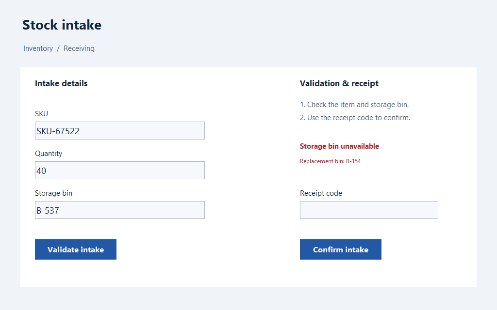
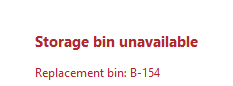

# VisionCache

**Computer use for AI agents on desktop apps, with fewer input tokens.**

VisionCache is a local MCP server for Windows and macOS. It gives agents a scaled view of a selected window, adds native-resolution detail when small text or red warnings appear, and lets agents click, scroll, type, and follow foreground dialogs.

**42.2% fewer API input tokens** in a live Windows word-processing benchmark. Input fell from **4,188 to 2,422 tokens per run**, and both capture modes completed all three trials. [See the benchmark](#measured-api-usage)

[Before and after](#how-it-works) · [Quickstart](#quickstart) · [npm](https://www.npmjs.com/package/visioncache) · [Benchmarks](#measured-api-usage) · [MCP tools](#use-the-mcp-tools) · [한국어](README.ko.md) · [简体中文](README.zh-CN.md)

## How it works

Here is what the agent receives when a storage-bin warning appears in the same Windows test window.

| Before · Full-resolution capture | After · VisionCache adaptive capture |
| --- | --- |
| <br>**Entire window** · 1024 × 640 | <br>**1. Scaled overview** · 512 × 320 |
| | <br>**2. Native-resolution warning crop** · 233 × 86 |

The overview keeps the whole form in view. The crop makes the replacement bin **B-154** readable at its original resolution. In the main window, VisionCache adds a crop when new small text or a red warning is detected. These PNGs came from VisionCache's Rust MCP server running against a test app with sample data.

On supported foreground dialogs, adaptive mode captures the dialog at native resolution. The connected MCP client decides where to send the images and metadata.

## Quickstart

Run VisionCache on the desktop you want the agent to control. The npm package supports **Windows x64 with Node.js 18 or later**. For macOS 14 or later, [build from source](#macos-build).

### Install with your agent

Paste this into a local Codex, Claude Code, or Gemini CLI session.

> Follow https://raw.githubusercontent.com/HosooJeong/VisionCache/main/INSTALL.md to install VisionCache for the agent I'm using on this computer, register its MCP server and desktop skill, and verify the connection.

### Install on Windows with npm

In PowerShell, install the package and register it with Codex.

```powershell
npm.cmd install --global visioncache
visioncache.cmd --install-codex
```

Open a new local Codex chat to load the server and skill. For Claude Code or Gemini CLI, use the [client setup guide](INSTALL.md).

### Try a desktop task

With a text editor open, ask your agent to use VisionCache.

> Use VisionCache to inspect the open text editor and tell me which controls are visible.

In Codex, you can explicitly select `$visioncache-desktop` for a desktop task.

## Measured API usage

A live OpenAI Responses API benchmark compared full-resolution and adaptive capture while an agent switched a Windows desktop document to landscape, opened print preview, and confirmed the page count and table borders. The test used `gpt-6.2-sol` and VisionCache's Python reference implementation. Each trial took four API calls. Both modes recorded zero cached input and cache-write tokens.

| Capture mode | Success | Input tokens per run | Total tokens per run | API cost per success | Median completion |
| --- | ---: | ---: | ---: | ---: | ---: |
| Full resolution | 3/3 | 4,188 | 4,309 | $0.009586 | 7.56 s |
| Adaptive | 3/3 | 2,422 | 2,543 | $0.006054 | 7.44 s |

Adaptive capture reduced total tokens by **41.0%** and usage-based API cost by **36.8%**. The figures use input and output usage reported by the API and the rates recorded for the benchmark. [API usage CSV](benchmarks/reference-hwp-2026-11-22.csv) · [Reproduce the test](benchmarks/README.md#word-processor-print-preview)

A separate Windows stock-intake fixture compared four capture modes, each with **8/8 successful trials**. Adaptive capture cost **45.5% less per success** than full resolution, and median completion went from 12.41 s to 11.85 s. [Four-mode results CSV](benchmarks/reference-2026-11-22.csv) · [All benchmark methods](benchmarks/README.md)

## Use the MCP tools

1. Call `list_windows` and pass the selected handle to `observe_window`. The response contains JSON metadata, the whole client-area image at index `0`, and any native-resolution detail.
2. Read `images[].source_box` for crop bounds. Pass the latest `observation_id` and image-local coordinates to `click`, `scroll`, or `fill`. Use `type_text` or `press_key` at the current keyboard focus. `map_point` converts image coordinates to Windows screen pixels or macOS screen points.
3. Observe again after input. The target must be in the foreground and its position must match the observation. Keep using the original window handle to follow its owned dialogs. Set `follow_owned=false` to capture only the requested window.

| Mode | Images returned |
| --- | --- |
| `adaptive_delta` (default) | Scaled overview and a native-resolution crop for newly changed small text or red warnings. Native resolution for an owned foreground dialog. |
| `full` | Native-resolution client area. Request this mode to inspect fine detail on demand. |
| `resized` | Scaled overview. |
| `resized_delta` | Scaled overview and a bounded crop of changed pixels. |

Crop eligibility depends on pixel height and color. Hardware-accelerated, elevated, and system windows can have capture or input restrictions. On macOS, input requires an accessible foreground window and a reliable hit target.

<details>
<summary>Manual stdio configuration</summary>

Use the native executable's absolute path in your client's MCP configuration. For a global Windows npm install, find the package under the directory printed by `npm.cmd root --global`.

```json
{
  "mcpServers": {
    "visioncache": {
      "command": "C:\\path\\to\\visioncache\\native\\visioncache-mcp.exe",
      "args": ["--scale", "0.5"]
    }
  }
}
```

</details>

## Platform support

| Platform | Install path | Status |
| --- | --- | --- |
| Windows x64 | [npm](#install-on-windows-with-npm) or [source build](#build-from-source-on-windows) | Native window capture, input, and local Codex integration verified. |
| macOS 14+ | [Source build](#macos-build) | Rust checks pass for Apple Silicon and Intel. On-device capture and input validation is pending. |

The native runtime requires an interactive desktop. It runs without a Python runtime or a model API credential.

## Build from source on Windows

Use the Rust MSVC toolchain.

```powershell
git clone https://github.com/HosooJeong/VisionCache.git
cd VisionCache
cargo build --locked --release
.\target\release\visioncache-mcp.exe --help
```

For a custom MCP client, substitute the built executable's absolute path in the [stdio example](#use-the-mcp-tools).

## macOS build

With Rust and Xcode Command Line Tools installed, run from the checkout.

```sh
MACOSX_DEPLOYMENT_TARGET=14.0 cargo build --locked --release
./target/release/visioncache-mcp --permissions
```

Register the absolute path to the binary as a stdio MCP server. Enable Screen Recording for capture and Accessibility for input as applicable. [macOS setup and smoke test](docs/macos-design.md)

## Register a source build in Codex

On Windows, run `.\target\release\visioncache-mcp.exe --install-codex`. On macOS, run `./target/release/visioncache-mcp --install-codex`. Use `--codex-cli` to give the Codex executable's path or `--scale` to set the overview size. Open a new local Codex chat to load the MCP server and skill.

## Native data path

The Windows adapter captures BGR scanlines with GDI and swaps two reusable buffers between observations. The macOS adapter converts ScreenCaptureKit images to BGR. The shared Rust pipeline compares frames, selects crops, resizes the overview, and encodes PNGs.

## Validation

```powershell
cargo test --locked
cargo clippy --locked --all-targets -- -D warnings
```

With a release binary built locally, use the Python harness to drive a disposable Windows GUI through MCP.

```powershell
python -m venv .venv
& .\.venv\Scripts\python.exe -m pip install -e ".[test]"
& .\.venv\Scripts\python.exe -m tests.windows_mcp_smoke --server .\target\release\visioncache-mcp.exe
```

## Related work

[DeltaVision](https://github.com/ddavidgao/deltavision) and [DeltaVision-OS](https://github.com/ddavidgao/deltavision-os) explore changed-region observations for browser and desktop agents.

## License

VisionCache is released under the MIT License. [License text](LICENSE)
