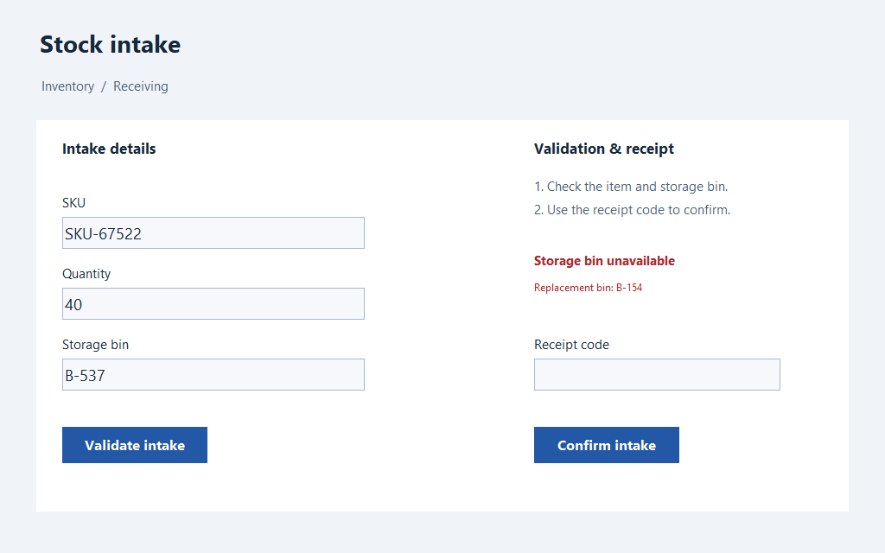
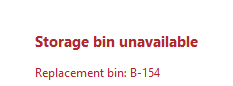

# VisionCache

**让 AI 智能体操控桌面应用，同时减少输入 token 用量。**

VisionCache 是适用于 Windows 和 macOS 的本地 MCP 服务。它为智能体提供所选窗口的缩小视图，在出现小字号文字或红色警告时补充原始分辨率的细节图。智能体可以通过它点击、滚动、输入文字，并跟踪前台对话框。

在 Windows 文字处理软件的实测中，**API 输入 token 减少了 42.2%**。每次运行的输入从 **4,188 降至 2,422 token**，两种截图方式都完成了全部三次任务。[查看测试结果](#api-用量实测)

[使用前后对比](#工作原理) · [快速开始](#快速开始) · [npm](https://www.npmjs.com/package/visioncache) · [MCP 工具](#使用-mcp-工具) · [English](README.md) · [한국어](README.ko.md)

## 工作原理

以下是同一个 Windows 测试窗口显示库位警告后，两种截图方式分别发送给智能体的图像。

| 使用前 · 全窗口原图 | 使用后 · VisionCache 自适应截图 |
| --- | --- |
| <br>**全窗口原图** · 1024 × 640 | <br>**1. 缩小后的窗口概览** · 512 × 320 |
| | <br>**2. 警告区域原图** · 233 × 86 |

缩小后的图像保留整个表单的布局，原始分辨率的局部截图让智能体看清替代库位 **B-154**。主窗口中新出现的小字号文字或红色警告会触发局部截图。这三张 PNG 由 VisionCache 的 Rust MCP 服务从使用样例数据的测试应用中获取。

对于支持的前台对话框，自适应模式会按原始分辨率截图。连接的 MCP 客户端决定将图像和元数据发送到哪里。

## 快速开始

请在智能体要操作的电脑上运行 VisionCache。npm 包适用于 **Windows x64 和 Node.js 18 或更高版本**。macOS 14 或更高版本可[从源码构建](#macos-构建)。

### 让智能体安装

将这句话粘贴到本地 Codex、Claude Code 或 Gemini CLI 会话中。

> 请阅读 https://raw.githubusercontent.com/HosooJeong/VisionCache/main/INSTALL.md ，为我当前使用的智能体安装 VisionCache，注册 MCP 服务和桌面技能，并验证连接。

### 在 Windows 上使用 npm 安装

在 PowerShell 中安装软件包并注册到 Codex。

```powershell
npm.cmd install --global visioncache
visioncache.cmd --install-codex
```

打开新的本地 Codex 会话以加载服务和技能。Claude Code 和 Gemini CLI 的注册方法请参阅[客户端设置指南（英文）](INSTALL.md)。

### 试用桌面任务

打开一个文本编辑器，然后向智能体发送以下请求。

> 请用 VisionCache 查看已经打开的文本编辑器窗口，并告诉我界面上有哪些可见控件。

在 Codex 中，可以显式调用 `$visioncache-desktop` 技能来处理桌面任务。

## API 用量实测

这项测试调用了 OpenAI Responses API，对比了全分辨率截图和自适应截图。智能体在 Windows 文字处理软件中将文档改为横向，打开打印预览，然后确认页数和表格边框。测试使用 `gpt-6.2-sol` 和 VisionCache 的 Python 参考实现。每次试验调用 API 四次，两种方式的缓存命中和写入 token 均为零。

| 截图方式 | 成功次数 | 每次输入 token | 每次总 token | 每次成功的 API 成本 | 完成时间中位数 |
| --- | ---: | ---: | ---: | ---: | ---: |
| 全分辨率 | 3/3 | 4,188 | 4,309 | $0.009586 | 7.56 秒 |
| 自适应 | 3/3 | 2,422 | 2,543 | $0.006054 | 7.44 秒 |

自适应截图使总 token 用量减少 **41.0%**，按实测用量计算的 API 成本减少 **36.8%**。数据来自 API 报告的输入和输出用量，费用按测试记录的费率计算。[API 用量数据（CSV）](benchmarks/reference-hwp-2026-11-22.csv) · [复现实验（英文）](benchmarks/README.md#word-processor-print-preview)

另一个 Windows 入库任务测试比较了四种截图方式，每种方式都成功完成 **8/8 次**。相较于全分辨率截图，自适应截图的每次成功成本低 **45.5%**，完成时间中位数从 12.41 秒降至 11.85 秒。[四种方式的结果（CSV）](benchmarks/reference-2026-11-22.csv) · [测试方法（英文）](benchmarks/README.md)

## 使用 MCP 工具

1. 调用 `list_windows`，将所选窗口的句柄传给 `observe_window`。响应包含 JSON 元数据、索引为 `0` 的整个客户区图像，以及可能附带的原始分辨率截图。
2. 从 `images[].source_box` 读取局部截图的边界。调用 `click`、`scroll` 或 `fill` 时，传入最新的 `observation_id` 和相对于该图像的坐标。使用 `type_text` 或 `press_key` 向当前键盘焦点发送输入。`map_point` 将图像坐标转换为 Windows 屏幕像素或 macOS 屏幕点。
3. 输入后重新截图。目标窗口须在前台，其位置须与截图时一致。继续使用原窗口句柄即可跟踪该窗口的附属对话框。设置 `follow_owned=false` 可只截图指定窗口。

| 模式 | 返回的图像 |
| --- | --- |
| `adaptive_delta`（默认） | 缩小后的窗口概览，加上新出现的小字号文字或红色警告的原始分辨率截图。附属的前台对话框使用原始分辨率。 |
| `full` | 整个客户区的原始分辨率图像，可用于按需查看细节。 |
| `resized` | 缩小后的窗口概览。 |
| `resized_delta` | 缩小后的窗口概览，加上像素变化区域的局部截图。 |

局部截图的选择取决于像素高度和颜色。硬件加速窗口、以管理员身份运行的窗口和系统窗口可能有截图或输入限制。在 macOS 上，输入要求前台窗口可通过辅助功能访问，并且目标位置可以可靠定位。

<details>
<summary>手动配置 stdio</summary>

在客户端的 MCP 配置中使用 VisionCache 二进制文件的绝对路径。通过 npm 在 Windows 上全局安装后，软件包位于 `npm.cmd root --global` 返回的目录下。

```json
{
  "mcpServers": {
    "visioncache": {
      "command": "C:\\path\\to\\visioncache\\native\\visioncache-mcp.exe",
      "args": ["--scale", "0.5"]
    }
  }
}
```

</details>

## 平台支持

| 平台 | 安装方式 | 状态 |
| --- | --- | --- |
| Windows x64 | [npm](#在-windows-上使用-npm-安装)或[从源码构建](#windows-源码构建) | 已验证原生窗口截图、输入和本地 Codex 集成。 |
| macOS 14+ | [从源码构建](#macos-构建) | Apple Silicon 和 Intel 均通过 Rust 交叉检查，实机截图和输入尚待验证。 |

原生程序需要可交互的桌面会话。运行时无需 Python 环境或模型 API 密钥。

已在 Windows x64 上使用公开的 npm 版本 `0.2.1` 验证中文窗口标题、窗口截图，以及简体和繁体中文文本输入。

## Windows 源码构建

使用 Rust 的 MSVC 工具链。

```powershell
git clone https://github.com/HosooJeong/VisionCache.git
cd VisionCache
cargo build --locked --release
.\target\release\visioncache-mcp.exe --help
```

使用其他 MCP 客户端时，将构建后的可执行文件绝对路径填入上面的 [stdio 配置示例](#使用-mcp-工具)。

## macOS 构建

在装有 Rust 和 Xcode Command Line Tools 的 Mac 上，从仓库根目录运行。

```sh
MACOSX_DEPLOYMENT_TARGET=14.0 cargo build --locked --release
./target/release/visioncache-mcp --permissions
```

使用二进制文件的绝对路径注册本地 stdio MCP 服务。截图需要屏幕录制权限，输入需要辅助功能权限。[macOS 设置及实机测试（英文）](docs/macos-design.md)

## 将源码构建版注册到 Codex

Windows 上运行 `.\target\release\visioncache-mcp.exe --install-codex`。macOS 上运行 `./target/release/visioncache-mcp --install-codex`。可用 `--codex-cli` 指定 Codex 可执行文件的路径，或用 `--scale` 设置窗口概览的缩放比例。注册后，打开新的本地 Codex 会话以加载 MCP 服务和技能。

## 原生图像处理

Windows 适配器通过 GDI 获取 BGR 扫描行，并交替复用两个缓冲区。macOS 适配器将 ScreenCaptureKit 图像转换为 BGR。共用的 Rust 处理流程负责比较图像、选取局部区域、缩放概览并编码 PNG。

## 验证

```powershell
cargo test --locked
cargo clippy --locked --all-targets -- -D warnings
```

本地构建 release 版本后，可用 Python 测试脚本通过 MCP 操作一个临时 Windows 测试窗口。

```powershell
python -m venv .venv
& .\.venv\Scripts\python.exe -m pip install -e ".[test]"
& .\.venv\Scripts\python.exe -m tests.windows_mcp_smoke --server .\target\release\visioncache-mcp.exe
```

## 相关项目

[DeltaVision](https://github.com/ddavidgao/deltavision) 和 [DeltaVision-OS](https://github.com/ddavidgao/deltavision-os) 探索了浏览器和桌面智能体的画面变化区域观测。

## 许可证

VisionCache 采用 MIT 许可证。[许可证全文](LICENSE)
