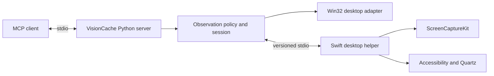

# macOS desktop adapter

**Status** · Design proposal. The Windows adapter is implemented. The macOS adapter needs implementation and verification on a real Mac before it can be listed as supported.

## Scope

Target **macOS 14 Sonoma and later**, starting with interactive sessions on Apple Silicon. Preserve the same MCP verbs and observation flow as Windows. The first milestone is window observation, click and keyboard input, and an attached dialog that can be opened and dismissed in a disposable TextEdit document. Intel hardware and additional macOS releases enter the support matrix when tested.

Keep Pillow-based image selection and MCP in Python. Add a persistent **Swift child process** for ScreenCaptureKit, Accessibility, and Quartz. The helper runs in the user's desktop session and has no network listener. Keeping capture and permission checks in the helper gives the macOS-specific code one execution boundary while leaving the Windows implementation and benchmark comparisons intact.

## Capture and coordinate contract

1. Enumerate on-screen windows with `SCShareableContent`. Use the `SCWindow.windowID` and owning PID as the native window identity, and show the title as a label. Revalidate the identity before capture and input.
2. Capture the chosen window with `SCContentFilter(desktopIndependentWindow:)` and `SCScreenshotManager.captureImage`. Set the output size from the filter's content rectangle and pixel scale, hide the cursor, omit the shadow, and return a PNG for the existing observation engine. Check the decoded size against the known capture geometry. [ScreenCaptureKit window filters](https://developer.apple.com/documentation/screencapturekit/capturing-screen-content-in-macos) · [Single-frame capture](https://developer.apple.com/documentation/screencapturekit/scscreenshotmanager) · [Pixel scale](https://developer.apple.com/documentation/screencapturekit/sccontentfilter/pointpixelscale)
3. Record the captured raster size in pixels and the rectangle it represents in **global macOS screen points**. The raster rectangle corresponds exactly to the returned PNG, excluding shadows. Resolve the rectangle against Core Graphics window geometry and verify it on Retina, non-Retina, and mixed-scale displays. [SCWindow fields](https://developer.apple.com/documentation/screencapturekit/scwindow) · [Coordinate checks](https://developer.apple.com/documentation/applicationservices/kaxpositionattribute)
4. Convert the chosen overview or crop coordinate to original capture pixels using the existing source box mapping. Convert that point to global screen points in the native adapter. Keep fractional points internally and allow negative global coordinates on secondary displays. Do not pass backing pixels directly to Quartz. For inputs, recheck bounds, PID, focus and placement after any display change.

For example, a 1,600×1,200 raster representing an 800×600 point rectangle at screen origin `(-800, 50)` maps raster point `(400, 200)` to screen point `(-600, 150)`. Expose the screen coordinate space in observation metadata so clients using `map_point` can distinguish macOS points from Windows screen pixels. Keep `images[].source_box` in original raster pixels on both platforms.

The current Python session uses a Win32 thread ID and an integer placement rectangle as part of window identity. Add a platform snapshot identity and coordinate transform to the adapter contract before connecting the helper. Keep the existing Windows tool response fields compatible. Invalidate previous frames on window, geometry, crop origin, or scale changes. A new observation or an attempted native action consumes the prior input token.

## Dialogs and input

- Treat an attached sheet within the captured window as part of that capture. If AX reports a newly attached sheet on the selected window, request a native-resolution view while the sheet is active.
- Follow a separate foreground dialog only when AX exposes an association to the selected window and the dialog can be uniquely correlated with a capturable window from the same PID. Bounds and title can help correlate a candidate, but matching only the PID is insufficient. If the relationship cannot be resolved, report the ambiguity and let the client select a window explicitly.
- Keep both requested and resolved handles in observation metadata. When a dialog closes, observing the original handle returns to the parent surface. A crop from one surface must never be mapped onto another.
- Use Accessibility to check the foreground application and focused window. For a point action, run system-wide AX hit testing and confirm the hit belongs to the current target before posting mouse events. Use Quartz keyboard events for supported chords and Unicode input. Recheck keyboard focus immediately before typing. A dialog of another process, a changed focus, or an ambiguous hit returns an error and a request for a fresh observation. [AX hit testing](https://developer.apple.com/documentation/applicationservices/1462077-axuielementcopyelementatposition) · [Core Graphics event APIs](https://developer.apple.com/documentation/coregraphics/core-graphics-functions)
- Preserve the meaning of `fill(replace=true)`, with the macOS select-all shortcut applied to a focused text field. If focus cannot be resolved, return an error before changing the field. macOS shortcuts use the platform's modifier semantics.

## Helper interface and permissions

Use private newline-delimited JSON over the child process's stdin and stdout, with stderr reserved for diagnostics. The first message negotiates a protocol version and capabilities. Requests carry one ID and one operation. Keep execution serialized, bound request and response sizes, and time out stalled operations. The helper accepts window and input operations only. It never runs a command supplied through MCP.

| Operation | Result |
| --- | --- |
| `hello` | Protocol version, helper version, OS version, and supported operations |
| `permissions` | Separate capture, Accessibility, and event-posting status |
| `list_windows` | Native window ID, owning PID, caption, and geometry |
| `capture` | Requested and resolved IDs, capture bounds in screen points, raster size, PNG, and snapshot token |
| `input` | Typed action for the current snapshot, with acceptance or a specific failure code |

Use `CGPreflightScreenCaptureAccess` to check screen capture, `AXIsProcessTrusted` for Accessibility, and `CGPreflightPostEventAccess` for event posting. Permit capture-only use when recording is available but input permissions are absent. Surface missing permissions to the user. Keep any macOS permission request in an explicit local setup step and test which app macOS names as responsible when launched from Terminal and from an MCP client. [Screen capture permission](https://developer.apple.com/documentation/screencapturekit) · [Accessibility trust](https://developer.apple.com/documentation/applicationservices/1460720-axisprocesstrusted) · [Core Graphics permission checks](https://developer.apple.com/documentation/coregraphics/core-graphics-functions)

Build the helper as a Swift Package Manager executable during the first milestone. Package a signed helper with a stable app identity when adding a distributable binary, then verify grant, restart, and revoke behavior with that exact artifact. Verify reproducible builds before publishing binaries.

## Implementation and acceptance

| Milestone | Acceptance evidence |
| --- | --- |
| Capture | Decode a selected-window PNG. Verify the raster, window bounds, and fallback behavior when recording permission is unavailable. |
| Input and mapping | Exercise click, scroll, Unicode text, and shortcuts. Check full, resized, and crop coordinates on 1× and 2× displays and a secondary display with a negative origin. |
| Dialog transitions | In TextEdit, enter test text, open a print sheet, inspect the preview, and dismiss it without printing. Check that the active surface returns to the same document and that stale modal coordinates are rejected. |
| Failure paths | Focus another app, move the target between displays, minimize or close it, and revoke input permission. Verify capture-only behavior where permitted and that input does not reach an unrelated window. |
| Evaluation | Compare full and adaptive observations on the same disposable Mac tasks and model. Record success, API calls, actual usage-based cost, and median completion time. Repeat the Windows MCP smoke test to catch regressions in the shared session. |

The 14+ deployment target, window-and-sheet geometry, and permission behavior are hypotheses for macOS validation. The paid Windows benchmark remains a separate result.
